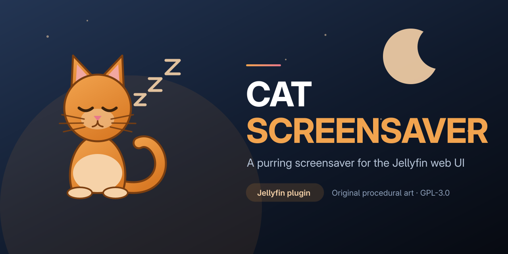
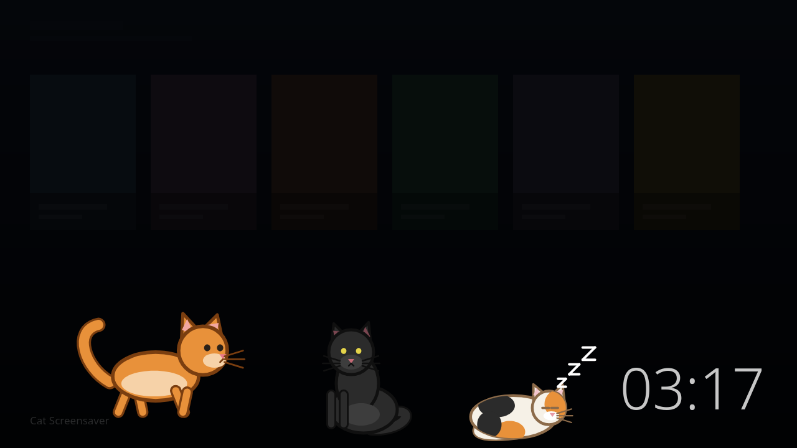

# Cat Screensaver



A screensaver for the Jellyfin **web interface**: after a configurable idle time the
screen fades to black and one or more original cats walk, sit, groom, stretch and fall
asleep. Any key, click or mouse movement wakes the UI instantly.



The art is drawn procedurally with canvas primitives. No sprites, GIFs or characters were
copied from another project; see [Art](#art).

## Client support

The script is injected into `jellyfin-web`, so it only works in clients that load the web
interface.

| Client | Works | Why |
|---|---|---|
| Browser (jellyfin-web) | ✅ | Receives the injected script |
| Jellyfin Media Player | ✅ (expected) | Embeds jellyfin-web |
| Jellyfin Android app | ✅ (expected) | Embeds jellyfin-web in a WebView |
| Android TV, Swiftfin, Roku, webOS native, Kodi | ❌ | Native UI, does not load jellyfin-web |

Only desktop browsers and the Firefox-based test environment have been exercised here.
The Media Player and Android rows are still marked as expected; please report results.

## Requirements

- Jellyfin **12.0 or newer**. Built against `Jellyfin.Controller` 12.1.0 with
  `targetAbi` 12.0.0.0; verified on Jellyfin 12.4.0.
- [File Transformation](https://github.com/IAmParadox27/jellyfin-plugin-file-transformation)
  installed and enabled. Without it the plugin still loads, but the script cannot be
  added to `index.html`.
- .NET 10 and Node.js 20+ only to build from source.

## Installation

### From a plugin repository

Add this URL in **Dashboard → Plugins → Repositories**:

```
https://github.com/undaniel/jellyfin-plugin-cat-screensaver/releases/latest/download/manifest.json
```

Install **Cat Screensaver** from the catalog and restart Jellyfin. The repository
manifest is generated by the release workflow with `jprm`.

### Manual build

```bash
dotnet build Jellyfin.Plugin.CatScreensaver.slnx
dotnet test Jellyfin.Plugin.CatScreensaver.slnx
```

The `.csproj` runs `npm ci` and `npm run build` before compiling and embeds
`Web/cat-screensaver.js` in the assembly. To package the DLL into a Jellyfin zip, use
`jprm plugin build .` or zip the DLL together with its metadata the same way as any
other plugin.

### Without File Transformation

The recommended fallback is the **JavaScript Injector** plugin, with this line:

```html
<script src="/CatScreensaver/cat-screensaver.js" defer></script>
```

With a Jellyfin base path, add it:

```html
<script src="/jellyfin/CatScreensaver/cat-screensaver.js" defer></script>
```

The injection performed by this plugin is relative (`../CatScreensaver/...`) so it keeps
working with a base path.

## Configuration

**Dashboard → Plugins → Cat Screensaver**

| Setting | Default | Range | Meaning |
|---|---|---|---|
| Enabled | on | | Master switch |
| Idle time | 180 s | 30–3600 | Wait before showing the overlay |
| Cats | 1 | 1–5 | Number of cats |
| Cat size | 1.0 | 0.5–3.0 | Relative to a 96 px sprite |
| Palettes | all | orange, black, gray, white, calico | Assigned in order |
| Background darkness | 0.85 | 0–1 | Opacity of the black layer |
| Clock | on | | Large `HH:MM` in a corner |
| During music | on | | Allow the screensaver while audio plays |
| Anti burn-in | on | | Move the clock every minute |
| User opt-out | on | | Add a toggle to the user menu |

The **Preview now** button opens the overlay immediately with the saved settings.
Any key or click closes it.

> **Important:** set Jellyfin's own screensaver (**Dashboard → Display**) to **None**.
> Otherwise both overlays can compete.

`GET /CatScreensaver/Config` returns only the fields above plus a
`FileTransformationAvailable` status flag. It is anonymous because it contains no
secrets; the script still refuses to start without a logged-in user.

## What it does

- `IdleDetector` checks once per second. It will not activate while a video is playing,
  while audio plays and `ActivateDuringMusic` is off, while the tab is hidden, or while
  an input, textarea or contenteditable element has focus.
- Mouse movement is throttled to 250 ms and ignores movements below 4 px.
- The overlay darkens the page, adds a full-screen canvas and an optional clock, with a
  600 ms fade in and 200 ms fade out.
- Every cat runs its own state machine: `walk`, `run`, `idle`, `sit`, `groom`, `stretch`,
  `sleep`. After ten minutes cats are twice as likely to fall asleep.
- Two cats walking closer than 80 px: one sits down instead of walking through the other.
- `prefers-reduced-motion: reduce` keeps every cat asleep and removes walking.
- The wake-up event is captured and swallowed, so the click that closes the screensaver
  does not press a Jellyfin button underneath. `mousemove` only closes.
- The loop stops completely when the overlay closes, pauses on `visibilitychange`, and
  drops to 30 fps if frames stay above 30 ms for three seconds.
- Sprites are baked once per palette, pose and frame, then drawn with `drawImage`.

### Per-user opt-out

With `AllowUserOptOut` on, the script adds
`🐈 Salvapantallas de gatos: Activado/Desactivado` to the Jellyfin side drawer. The
preference lives in `localStorage["catScreensaver.disabled"] = "1"` for that browser.
If Jellyfin changes its menu markup, the entry is skipped; the rest keeps working.

### SPA and duplicate guards

The transformer refuses to inject the script twice, and the script guards itself with
`window.__catScreensaverBooted`. Navigating inside jellyfin-web does not add duplicate
overlays or listeners.

## Art

The cat is original work for this plugin, drawn in `web/src/art.js` with ellipses,
triangles, rounded lines and Bézier tails. Palettes: orange, black, gray, white and
calico (seeded patches per cat).

Every baked frame is visible in [`docs/poses.png`](docs/poses.png).

The icon and banner in `images/` are also original SVG artwork, rendered to PNG for the
Jellyfin repository listing.

## Development

```bash
cd web
npm ci
npm test          # Vitest + jsdom, pure idle and brain logic
npm run build     # esbuild -> Jellyfin.Plugin.CatScreensaver/Web/cat-screensaver.js
```

Open `web/demo.html` through any static server (ES modules do not load from `file://`):

```bash
python3 -m http.server 8765 --directory web
# http://127.0.0.1:8765/demo.html
```

The standalone demo activates after 10 seconds. The real plugin uses the configured
30–3600 second timeout.

Build without touching Node after the bundle exists:

```bash
dotnet build -p:SkipJsBuild=true Jellyfin.Plugin.CatScreensaver.slnx
```

`web/poses.html` and `web/screenshot.html` are the pages used to render the images in
`docs/`.

### Tests

- `web/test/idle.test.js`: timeout, video, audio, hidden tab, typing, clamping.
- `web/test/brain.test.js`: every transition in the table, fixed-rng boundaries,
  duration ranges, movement, borders, tired sleep weight, cat separation.
- `Jellyfin.Plugin.CatScreensaver.Tests`: injection point, idempotence, missing body tag,
  relative base path.

## Performance

The target is under 5 % CPU with five cats on a normal laptop. The design keeps the loop
cheap: pre-rendered sprites, one `requestAnimationFrame`, no DOM work per frame, no loop
at all while closed, and an automatic 30 fps mode. Actual CPU use depends on screen size,
device pixel ratio and browser; measure with the browser's performance monitor if your
hardware is constrained.

## License

GPL-3.0. See [LICENSE](LICENSE).
